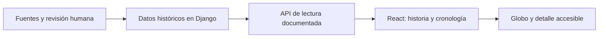

# Plan: primera historia en Historical Earth

Fecha: 2026-11-15  
Estado: propuesta para revisión; no implementada  
Referencia revisada: commit `876fc57` y archivos sin seguimiento presentes en el directorio de trabajo.

## Objetivo y alcance

Permitir que una persona explore una primera historia mediante una secuencia breve de acontecimientos, una cronología y su ubicación en un globo, con acceso a las fuentes y a la incertidumbre. La misión existente propone la expansión de Roma: se recomienda comenzar con una narración acotada de 3 a 5 hitos, pero el tema y periodo exactos quedan pendientes de elección. No se han investigado ni verificado esos hitos.

El proyecto contiene instrucciones y coordinación, pero no se encontraron aplicación, dependencias, modelos, API ni interfaz implementados. Django, React y globo 3D son arquitectura prevista; sus versiones y biblioteca del globo están pendientes de selección y prueba. Los archivos propuestos a continuación son nuevos, no componentes existentes.

## Experiencia propuesta

En una única pantalla pública de lectura: encabezado con título y descripción de la historia; globo como área principal; lista cronológica seleccionable; panel con fecha, lugar, explicación, clasificación de incertidumbre y enlaces a fuentes del hito seleccionado. Seleccionar un hito actualiza el panel y centra el globo cuando haya ubicación utilizable. La cronología también funciona con teclado y sirve como alternativa textual al globo. En móvil, mostrar globo, cronología y detalle en orden vertical, sin ocultar las fuentes.

Estados: carga con anuncio accesible; error de conexión con reintento; historia o lista vacía con explicación; ubicación desconocida sin marcador; globo no disponible con lista y detalle utilizables. No depender del color, movimiento ni interacción 3D para transmitir información. Respetar movimiento reducido y disponer de foco visible y etiquetas. No se requiere inicio de sesión para lectura pública en esta primera iteración; confirmar antes de publicar.

## Evidencia y datos

Primero elegir historia y periodo; después localizar fuentes identificables, revisar derechos de uso y registrar por afirmación referencia y localizador, revisión, precisión temporal y geográfica. No se incluyen fuentes ni fechas aún porque no han sido verificadas. Las coordenadas modernas de un lugar histórico deben indicarse como aproximación cuando corresponda. No se dibujarán fronteras ni rutas históricas sin evidencia geográfica y licencia adecuadas. Una eventual maqueta sintética debe identificarse de forma visible en datos e interfaz y nunca confundirse con la historia documentada.

Modelo conceptual propuesto: `Historia` (id, título, resumen, estado), `Hito` (id, historia, orden, texto, fecha o intervalo, precisión, lugar opcional y precisión espacial), `Fuente` (autor/institución, título, fecha o edición, URL o referencia, derechos conocidos) y vínculo afirmación-fuente (localizador, estado y notas de incertidumbre). El diseño temporal debe admitir años anteriores a la era común, intervalos y precisión desconocida; no confiar en tipos de fecha que impidan esos casos. Separar material documentado, interpretación y demostración.

## Arquitectura y contrato pendientes

Propuesta mínima: Django conserva y valida los datos; React consulta una API de lectura y mantiene localmente el hito seleccionado. SQLite puede servir para desarrollo local inicial; evaluar PostgreSQL cuando existan necesidades concretas. Comparada con contenido fijo en React, una API añade preparación inicial, pero sostiene trazabilidad y evolución del proyecto. Una maqueta aislada puede usar datos explícitamente sintéticos para probar el diseño sin simular integración.

El contrato OpenAPI se acordará antes de integrar. Como solicitud provisional, la pantalla necesita consultar una historia por identificador y recibir metadatos, hitos ordenados, fechas y precisión, localizaciones opcionales, fuentes y estados de evidencia; también necesita errores de historia inexistente y de servicio. Definir rutas, esquema, formato de errores y compatibilidad en `docs/api/openapi.yaml` durante el diseño conjunto; no hay endpoints confirmados. API pública de solo lectura propuesta, sin asumir mecanismos de autenticación futuros. No incorporar procesamiento automático de documentos en esta entrega.

## Tareas y dependencias

Todas están pendientes; los responsables indican perfiles de trabajo y pueden ejecutarse secuencialmente. No se ha delegado ni ejecutado trabajo de otros agentes.

| ID | Prioridad / responsable | Dependencias | Resultado y aceptación | Validación |
|---|---|---|---|---|
| H1 | P0 / orquestación y usuario | Ninguna | Elegir historia, periodo y alcance de 3–5 hitos; registrar decisiones. | Revisar que pueda contarse sin fronteras no sustentadas. |
| H2 | P0 / investigación histórica | H1 | Fichas de fuentes, derechos conocidos, afirmaciones, localizadores y dudas; excluir afirmaciones sin respaldo. | Revisar cada afirmación contra sus fuentes; registrar lo no comprobado. |
| H3 | P0 / datos y arquitectura Django | H1; H2 para datos finales | Esquema versionado de fechas, ubicaciones, fuentes y estados; acordar contrato OpenAPI con React. | Ejemplos válidos e inválidos, años a. e. c., intervalos y lugar desconocido. |
| H4 | P0 / arquitectura y desarrollo Django | H3 | Crear `backend/`, datos revisados, validaciones y API de lectura conforme al contrato. | Pruebas de modelo, respuesta, error e integridad de fuentes; verificar contrato. |
| H5 | P0 / arquitectura React y globo | H3 para interfaz de datos | Diseñar pantalla y seleccionar biblioteca 3D con prototipo; crear `frontend/` y componentes con alternativa textual. | Comprobar teclado, móvil, movimiento reducido, fallo de WebGL y liberación de recursos. |
| H6 | P0 / desarrollo React | H4 y H5 | Conectar API, cronología, globo y detalle; mostrar fuentes, precisión y estados. | Pruebas de interacción, carga, vacío, error, reintento y selección. |
| H7 | P0 / QA e investigación | H2 y H4–H6 | Revisar flujo completo y correspondencia con las fuentes; documentar limitaciones. | Prueba integrada de extremo a extremo, accesibilidad básica y revisión histórica manual. |

H2 y el diseño inicial de H3 pueden avanzar tras H1; H4 y H5 pueden avanzar tras acordar el contrato, en carpetas separadas. H3 no queda aceptada para datos finales hasta incorporar H2. H6 requiere la API real y la interfaz del globo; H7 verifica la integración. Durante el trabajo secuencial se respetará este orden y los documentos de rol correspondientes.

## Criterios de entrega

- Una persona abre la historia, selecciona cada hito y consulta su detalle y fuente localizable.
- Cronología, detalle y marcador concuerdan; la información incierta o inexistente se muestra sin precisión inventada.
- No hay geometrías territoriales o rutas no sustentadas; cualquier muestra sintética se identifica claramente.
- La lectura principal funciona con teclado, en móvil y cuando el globo no carga; carga, vacío y errores son comprensibles.
- Django y React cumplen el contrato acordado y las pruebas relevantes pasan; se registran comandos, resultados y límites reales.
- Existe una guía local de arranque y se documentan versiones y licencias de dependencias y recursos utilizados.

## Riesgos y siguiente decisión

La selección de fuentes y licencias puede limitar el relato; la precisión geográfica puede ser insuficiente para representar un territorio; WebGL puede no estar disponible; el contrato puede cambiar durante la exploración. Mitigar con revisión por afirmación, marcadores aproximados o ausencia de geometría, alternativa textual y contrato versionado antes de integración. Sin mediciones no se prometen objetivos de rendimiento. Fuera de alcance: carga automática de documentos, cuentas, reproducción temporal avanzada y despliegue público.

Siguiente paso: decidir si la primera historia será Roma y acotar su periodo; luego iniciar H2 y H3. El plan no autoriza ni presupone despliegue o publicación externa.
